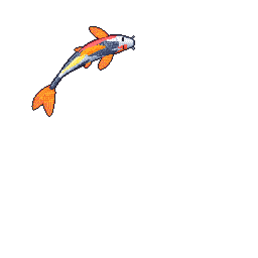

# Hi, I'm Monowar Husain 👋

### Full-Stack & Systems Developer · CS Undergraduate @ BracU

I build robust, end-to-end applications and systems infrastructure—from clean database schemas and performant APIs to responsive web and mobile interfaces.

---

## About me

I'm a Computer Science and Engineering undergraduate at **BRAC University** interested in building reliable software systems and full-stack web platforms that solve real-world friction.

- I work across **full-stack web development, mobile applications, databases, and Linux systems architecture**.
- I write technical tutorials, write-ups, and developer guides at [ac.monowar.me](https://ac.monowar.me/).
- I serve as an **IAAC Ambassador**, promoting science and astronomy outreach.
- I enjoy taking projects through their complete lifecycle: system design, backend APIs, responsive frontends, automated scripts, and deployment.
- **Fun fact:** Film enthusiast with over 600+ movies logged!

> I care less about just getting code to run and more about how it scales, how robust its architecture is, and how cleanly it solves problems.

---

## Engineering toolbox

### Languages

### Web & Frontend

### Mobile & Apps

### Backend, Databases & Cloud

### Systems, Networking & Tools

---

## How I approach engineering

| Principle | What it means in practice |
|---|---|
| **Clean Architecture** | Code should be modular, maintainable, and easy for other developers to reason about. |
| **Performance First** | Efficient database queries, minimal bundle sizes, and optimal resource utilization matter. |
| **Documenting the Journey** | Writing clear technical write-ups helps solidify learning and contributes back to the community. |
| **Practical Problem Solving** | Building software that actively tackles friction in real-world scenarios. |

---

### Let's connect

I'm open to software engineering opportunities, full-stack development roles, and collaborative tech projects compatible with **Dhaka time (UTC+06:00)**.

Build deliberately. Write cleanly. Keep learning.

